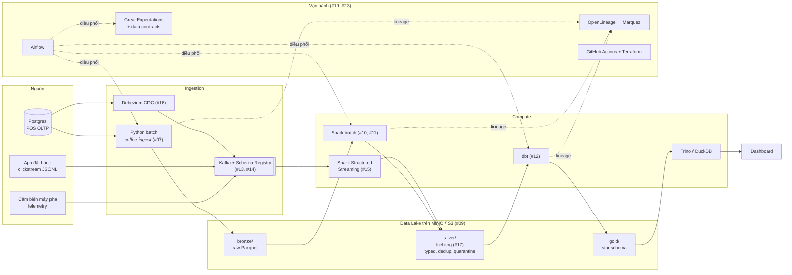

# Data Engineer từ A–Z

[](https://github.com/sophie-nguyenthuthuy/data-engineer-a-z/actions/workflows/ci.yml)
[](LICENSE)
[](LICENSE-CONTENT)

Khoá học YouTube **miễn phí**, tiếng Việt, 24 video chia 4 phần. Thay vì 24 ví dụ rời rạc, cả khoá xây **một** dự án duy nhất: data platform cho chuỗi cà phê 30 cửa hàng, dữ liệu từ máy POS, app đặt hàng và cảm biến máy pha espresso. Mỗi video bạn xem → làm lab trong repo này → trả lời một câu hỏi phỏng vấn. Toàn bộ phần 1–2 chạy trên laptop với Docker, **không cần tài khoản cloud**.

- 📺 Playlist: `TODO:youtube-link`
- ▶️ Video #00 — giới thiệu & cài đặt: `TODO:youtube-link` · [thư mục lab](videos/00-intro)

## Bạn sẽ xây gì

Chuỗi cà phê **Phin Phố**: 15 cửa hàng ở Hà Nội, 15 ở TP.HCM, ~6.000 hoá đơn/ngày, giá VND, cao điểm 7–9h và 14–16h, Tết thì vắng, mưa thì đặt app nhiều hơn. Dữ liệu được sinh bằng [`coffeegen`](data/generator) (deterministic) và **cố ý có 1–2% lỗi** — duplicate, thiếu `store_id`, timestamp lệch múi giờ, số lượng âm — vì phần lớn công việc thật của Data Engineer là xử lý chúng.

Kiến trúc khi học hết 24 video:



Chi tiết từng phần: [docs/architecture.md](docs/architecture.md).

## Yêu cầu

| | Tối thiểu | Khuyến nghị |
|--|-----------|-------------|
| Laptop | 8 GB RAM, 4 core, 20 GB trống (đủ cho phần 1–2) | 16 GB RAM (chạy được `PROFILE=all` ở phần 3–4) |
| Hệ điều hành | macOS, Windows 10/11 (WSL 2), Ubuntu | |
| Phần mềm | Docker Desktop (hoặc Docker Engine), Git, [uv](https://docs.astral.sh/uv/) | VS Code + extension Docker, Python |
| Kiến thức | Biết lập trình cơ bản ở bất kỳ ngôn ngữ nào | Đã dùng SQL một chút |
| Cloud | **Không cần.** AWS chỉ là tuỳ chọn ở video #09 và #22 | |

Hướng dẫn cài từng hệ điều hành và xử lý lỗi: [SETUP.md](SETUP.md).

## Bắt đầu nhanh

```bash
git clone https://github.com/sophie-nguyenthuthuy/data-engineer-a-z.git && cd data-engineer-a-z
make install                                  # .venv + coffeegen + coffee-ingest + dev tools
make up                                       # postgres + minio + jupyter (lần đầu ~5 phút)
docker compose exec postgres psql -U coffee -d coffee_pos -c "SELECT count(*) FROM pos_transactions;"
make smoke                                    # pipeline đầu tiên: samples → bronze → silver (./lake-local)
```

Thấy số hoá đơn > 0 và thư mục `lake-local/silver/` xuất hiện là xong. Jupyter ở http://localhost:8888 (token `dea2z`), MinIO ở http://localhost:9001.

## Danh sách video

Phát hành **thứ Ba và thứ Sáu, 19:00** (giờ Việt Nam), bắt đầu 03/11/2026. 🟢 đã phát hành · ⚪ sắp ra.

### Phần 1 — Nền tảng
| # | Tiêu đề | Lab | YouTube | Trạng thái | Ngày |
|---|---------|-----|---------|------------|------|
| 00 | Giới thiệu khoá học & cài đặt | [00-intro](videos/00-intro) | `TODO:youtube-link` | ⚪ | 03/11/2026 |
| 01 | Data Engineer là gì? Lộ trình từ số 0 | [01-data-engineer-la-gi](videos/01-data-engineer-la-gi) | `TODO:youtube-link` | ⚪ | 06/11/2026 |
| 02 | Kiến trúc dữ liệu hiện đại: OLTP, OLAP, Warehouse, Lake | [02-kien-truc-du-lieu](videos/02-kien-truc-du-lieu) | `TODO:youtube-link` | ⚪ | 10/11/2026 |
| 03 | SQL cho Data Engineer: window function, CTE, query plan | [03-sql-cho-data-engineer](videos/03-sql-cho-data-engineer) | `TODO:youtube-link` | ⚪ | 13/11/2026 |
| 04 | Python cho Data Engineer: Pandas, Polars, DuckDB | [04-python-cho-data-engineer](videos/04-python-cho-data-engineer) | `TODO:youtube-link` | ⚪ | 17/11/2026 |
| 05 | Docker cho Data Engineer | [05-docker-cho-data-engineer](videos/05-docker-cho-data-engineer) | `TODO:youtube-link` | ⚪ | 20/11/2026 |
| 06 | Data Modeling: Star Schema, Snowflake, Data Vault | [06-data-modeling](videos/06-data-modeling) | `TODO:youtube-link` | ⚪ | 24/11/2026 |

### Phần 2 — Batch & Lưu trữ
| # | Tiêu đề | Lab | YouTube | Trạng thái | Ngày |
|---|---------|-----|---------|------------|------|
| 07 | ETL vs ELT: pipeline đầu tiên bằng Python | [07-etl-vs-elt](videos/07-etl-vs-elt) | `TODO:youtube-link` | ⚪ | 27/11/2026 |
| 08 | Định dạng file: Parquet, Avro, ORC, Delta | [08-dinh-dang-file](videos/08-dinh-dang-file) | `TODO:youtube-link` | ⚪ | 01/12/2026 |
| 09 | Data Lake trên S3: bronze/silver/gold | [09-data-lake-s3](videos/09-data-lake-s3) | `TODO:youtube-link` | ⚪ | 04/12/2026 |
| 10 | Apache Spark từ số 0 | [10-apache-spark](videos/10-apache-spark) | `TODO:youtube-link` | ⚪ | 08/12/2026 |
| 11 | Tối ưu Spark: skew, broadcast, AQE | [11-toi-uu-spark](videos/11-toi-uu-spark) | `TODO:youtube-link` | ⚪ | 11/12/2026 |
| 12 | dbt | [12-dbt](videos/12-dbt) | `TODO:youtube-link` | ⚪ | 15/12/2026 |

### Phần 3 — Streaming & Lakehouse
| # | Tiêu đề | Lab | YouTube | Trạng thái | Ngày |
|---|---------|-----|---------|------------|------|
| 13 | Kafka từ số 0 | [13-kafka](videos/13-kafka) | `TODO:youtube-link` | ⚪ | 18/12/2026 |
| 14 | Exactly-once / at-least-once, DLQ, schema registry | [14-delivery-semantics-dlq-schema-registry](videos/14-delivery-semantics-dlq-schema-registry) | `TODO:youtube-link` | ⚪ | 22/12/2026 |
| 15 | Spark Structured Streaming: watermark, window | [15-spark-structured-streaming](videos/15-spark-structured-streaming) | `TODO:youtube-link` | ⚪ | 25/12/2026 |
| 16 | CDC với Debezium | [16-cdc-debezium](videos/16-cdc-debezium) | `TODO:youtube-link` | ⚪ | 29/12/2026 |
| 17 | Lakehouse: Iceberg vs Delta vs Hudi | [17-lakehouse-iceberg-delta-hudi](videos/17-lakehouse-iceberg-delta-hudi) | `TODO:youtube-link` | ⚪ | 01/01/2027 |
| 18 | Kiến trúc streaming end-to-end | [18-kien-truc-streaming-end-to-end](videos/18-kien-truc-streaming-end-to-end) | `TODO:youtube-link` | ⚪ | 05/01/2027 |

### Phần 4 — Vận hành
| # | Tiêu đề | Lab | YouTube | Trạng thái | Ngày |
|---|---------|-----|---------|------------|------|
| 19 | Airflow | [19-airflow](videos/19-airflow) | `TODO:youtube-link` | ⚪ | 08/01/2027 |
| 20 | Data Quality: Great Expectations, dbt test, contracts | [20-data-quality](videos/20-data-quality) | `TODO:youtube-link` | ⚪ | 12/01/2027 |
| 21 | Observability & Lineage: OpenLineage, Marquez | [21-observability-lineage](videos/21-observability-lineage) | `TODO:youtube-link` | ⚪ | 15/01/2027 |
| 22 | CI/CD + Terraform | [22-cicd-terraform](videos/22-cicd-terraform) | `TODO:youtube-link` | ⚪ | 19/01/2027 |
| 23 | Chi phí & bảo mật: FinOps, PII, access control | [23-chi-phi-bao-mat](videos/23-chi-phi-bao-mat) | `TODO:youtube-link` | ⚪ | 22/01/2027 |
| 24 | Portfolio, CV, phỏng vấn | [24-portfolio-phong-van](videos/24-portfolio-phong-van) | `TODO:youtube-link` | ⚪ | 26/01/2027 |

## Cách học hiệu quả

1. **Xem video** một lượt, không gõ theo. Hiểu *tại sao* trước *làm thế nào*.
2. **Làm lab** trong `videos/NN-slug/lab/` — code có `TODO`, tự làm trước, chỉ mở `solution/` khi đã thử ít nhất 20 phút. Mỗi README có mục **Kết quả mong đợi** để bạn tự kiểm tra.
3. **Trả lời câu hỏi phỏng vấn** cuối mỗi video dưới phần comment YouTube. Mình đọc và ghim câu trả lời hay nhất. Đến video #24 bạn có 24 câu trả lời của chính mình — đó là tài liệu ôn phỏng vấn tốt nhất.
4. Kẹt → mở issue theo mẫu **Lab question**. Viết lại lỗi cho người khác hiểu cũng là kỹ năng cần luyện.

Mỗi tuần 2 video + 2 lab ≈ 4–6 giờ. Hết khoá: 12 tuần.

## Đóng góp & hỏi bài

- **Hỏi bài**: [Issues](https://github.com/sophie-nguyenthuthuy/data-engineer-a-z/issues/new/choose) → mẫu *Lab question*. Nhớ dán output của `make ps` và lệnh bạn chạy.
- **Báo lỗi** repo/lab: mẫu *Bug report*.
- **Thảo luận** rộng hơn (lộ trình, công cụ, kinh nghiệm đi làm): [Discussions](https://github.com/sophie-nguyenthuthuy/data-engineer-a-z/discussions).
- **Pull request** rất hoan nghênh: sửa chính tả, sửa lab, thêm bài tập. Quy tắc trong [PULL_REQUEST_TEMPLATE](.github/PULL_REQUEST_TEMPLATE.md): một PR một việc, CI xanh (`make lint test dbt-parse`), tiếng Việt cho nội dung học, tiếng Anh cho code. Thay đổi lớn hãy mở issue bàn trước.

License: code [MIT](LICENSE), slide và tài liệu [CC BY-NC-SA 4.0](LICENSE-CONTENT) — dùng lại thoải mái để tự học và dạy miễn phí, ghi nguồn; không dùng cho khoá học thu phí.

## Về mình

Mình là Thuỷ. Hiện là Head of Tech & Data, đồng thời giảng dạy Data Engineering & Big Data tại Học viện Ngân hàng. Trước đó mình làm ở FPT Smart Cloud và AWS Professional Services. GitHub: [@sophie-nguyenthuthuy](https://github.com/sophie-nguyenthuthuy).
