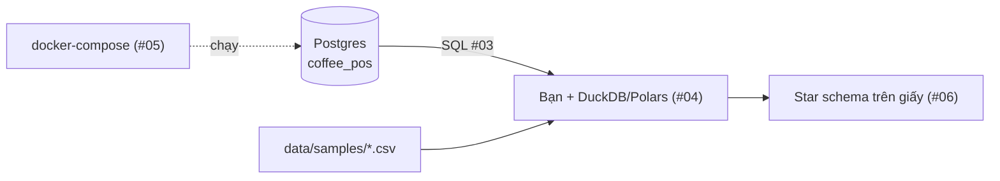
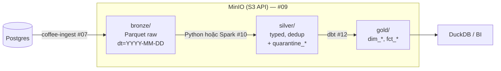
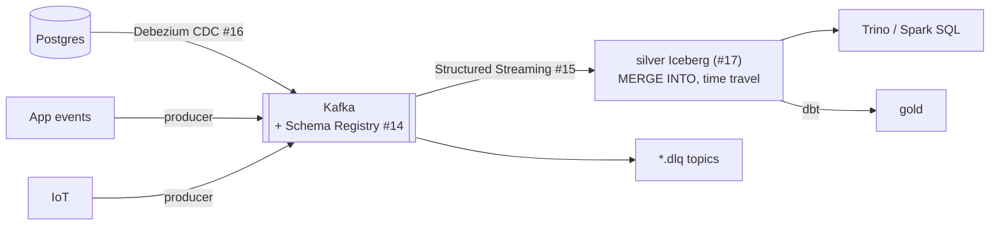
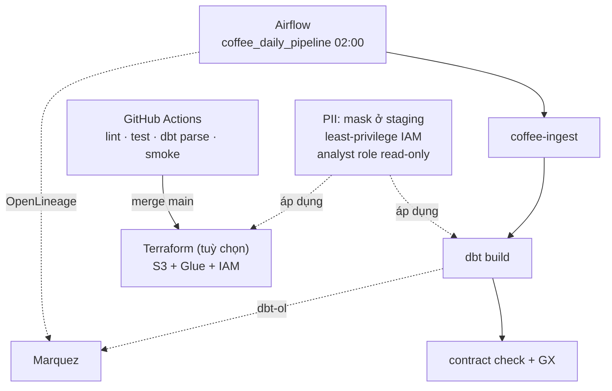

# Kiến trúc data platform Phin Phố — lớn dần theo từng phần

Tài liệu này là "bản vẽ sống": mỗi phần của khoá học thêm một mảnh. Sơ đồ cuối cùng ở [README](../README.md#bạn-sẽ-xây-gì).

## Bối cảnh nghiệp vụ

- 30 cửa hàng (15 Hà Nội, 15 TP.HCM), ~200 hoá đơn/cửa hàng/ngày, 35% qua app.
- 3 nguồn dữ liệu, 3 "hình dạng" khác nhau:

| Nguồn | Hệ thống | Tần suất | Hình dạng | Vấn đề điển hình |
|-------|----------|----------|-----------|------------------|
| POS | Postgres OLTP | giao dịch liên tục, batch lấy theo ngày | bảng quan hệ | duplicate do retry, `store_id` null, timestamp lệch múi giờ, quantity âm |
| App đặt hàng | backend gửi event | event, vài trăm/phút | JSON lồng nhau | event tới muộn, schema đổi theo version app |
| Máy pha espresso | cảm biến IoT | 0.2 Hz/máy × 60 máy | time series | out-of-order, null reading, counter reset |

Câu hỏi mà platform phải trả lời: doanh thu/margin theo ngày × cửa hàng × món × kênh; phễu app; cảnh báo máy pha quá nhiệt; ảnh hưởng của Tết và mưa.

## Phần 1 — Nền tảng (video #01–#06)

Chưa có "platform". Chỉ có nguồn, laptop và Docker.

Quyết định quan trọng ở phần này: **mọi thứ chạy local, dữ liệu nhỏ, hiểu bản chất trước công cụ.**

## Phần 2 — Batch & Lưu trữ (video #07–#12)

| Quyết định | Lựa chọn | Vì sao |
|-----------|----------|--------|
| Định dạng (#08) | Parquet + zstd | cột, nén tốt, mọi engine đọc được |
| Partition | `dt=` theo ngày nghiệp vụ | query theo ngày nhiều nhất; re-run ghi đè 1 partition |
| Timestamp | lưu UTC, hiển thị giờ VN | sửa tz drift đúng một chỗ (silver) |
| ETL hay ELT | EL + light T bằng Python, T nặng bằng dbt | code Python kiểm thử được; SQL cho logic nghiệp vụ dễ review |
| Spark khi nào (#10, #11) | khi dữ liệu không vừa một máy | 30 cửa hàng thì Polars đủ — Spark ở đây để **học**, và để sẵn khi mở rộng |

## Phần 3 — Streaming & Lakehouse (video #13–#18)

| Quyết định | Lựa chọn | Vì sao |
|-----------|----------|--------|
| Kafka KRaft, không ZooKeeper | ít container hơn, chuẩn mới | |
| Delivery (#14) | at-least-once + consumer idempotent theo `transaction_id` | exactly-once end-to-end đắt; dedup rẻ |
| Table format (#17) | Iceberg | catalog mở, nhiều engine, hidden partitioning |
| Watermark (#15) | 10 phút | generator tạo late event 1–10 phút — đo rồi mới chọn |
| Kappa hay Lambda (#18) | Lambda "thực dụng": batch là nguồn sự thật, streaming phục vụ dashboard gần thời gian thực | chuỗi 30 cửa hàng không cần exactly-once real-time cho báo cáo tài chính |

## Phần 4 — Vận hành (video #19–#23)

| Quyết định | Lựa chọn | Vì sao |
|-----------|----------|--------|
| Orchestrator (#19) | Airflow 2.9 LocalExecutor | phổ biến nhất trong JD ở VN; LocalExecutor đủ cho laptop |
| Quality (#20) | 3 lớp: contract (rẻ) → dbt test → GX (đắt) | fail sớm, fail rẻ |
| Lineage (#21) | OpenLineage → Marquez | chuẩn mở, Airflow/Spark/dbt đều có integration |
| CI (#22) | không cần service nào: dbt parse với DuckDB, smoke trên samples | CI xanh trong 3 phút, chạy được trên fork của học viên |
| PII (#23) | không đưa PII lên gold; mask ở staging; hash có salt khi cần join | giảm bề mặt rủi ro thay vì "bảo vệ" bề mặt lớn |

## Những gì cố ý KHÔNG làm

- Không Kubernetes, không managed service bắt buộc — laptop 8 GB là ưu tiên.
- Không Flink (chọn Spark Structured Streaming để dùng một engine cho cả batch và streaming trong khoá nhập môn).
- Không real-time exactly-once end-to-end — giải thích chi phí ở #14 và #18.
- Không data catalog thương mại; Marquez đủ để hiểu khái niệm.
