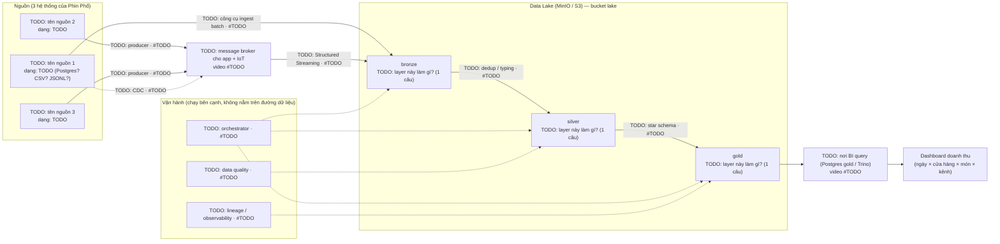

# Lab #01 — Sơ đồ luồng dữ liệu của Phin Phố

Điền các ô `TODO` trong sơ đồ dưới. Mỗi mũi tên ghi **công cụ** và **số video** dạy công cụ đó (ví dụ `Spark · #10`).
Tra cứu: [SCHEMA.md](../../../data/generator/SCHEMA.md) cho nguồn, [videos/README.md](../../README.md) cho số video,
docstring trong [bronze.py](../../../platform/ingestion/src/coffee_ingestion/bronze.py) / [silver.py](../../../platform/ingestion/src/coffee_ingestion/silver.py) cho ý nghĩa từng layer.

Render: dán khối mermaid vào https://mermaid.live hoặc xem trực tiếp trên GitHub.

## Câu hỏi tự kiểm (trả lời ngắn ngay dưới đây)

1. Vì sao bronze **không** sửa gì cả, kể cả khi biết dữ liệu sai?
   > TODO

2. Dữ liệu `tz_drift` (ts thiếu `+07:00`) được sửa ở layer nào? Ai phát hiện nếu không sửa?
   > TODO

3. Nếu dashboard sai số, bạn đi ngược sơ đồ từ đâu tới đâu?
   > TODO
