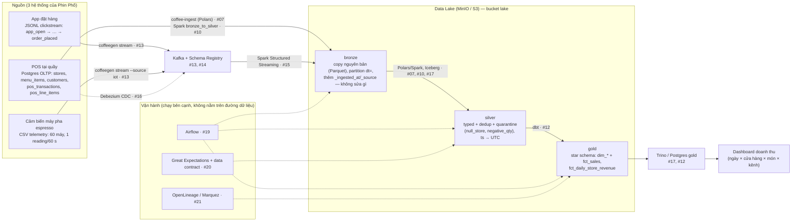

# Lời giải #01 — Sơ đồ luồng dữ liệu của Phin Phố

Đây là sơ đồ mình dùng cho cả khoá. Mỗi mũi tên là một (hoặc vài) video.

Đối chiếu với code thật trong repo:

| Node | Code |
|------|------|
| bronze | [`platform/ingestion/src/coffee_ingestion/bronze.py`](../../../../platform/ingestion/src/coffee_ingestion/bronze.py) — "bronze never cleans, never filters, never changes a value" |
| silver | [`silver.py`](../../../../platform/ingestion/src/coffee_ingestion/silver.py) — `clean_transactions`, `clean_line_items`, `parse_vn_timestamp` |
| gold | [`platform/dbt/models/marts/`](../../../../platform/dbt/models/marts) — `dim_store`, `dim_menu_item`, `dim_customer`, `dim_date`, `fct_sales` |
| streaming | [`platform/spark/streaming_pos_agg.py`](../../../../platform/spark/streaming_pos_agg.py) |
| ops | [`platform/airflow/dags/`](../../../../platform/airflow/dags), [`platform/quality/`](../../../../platform/quality), [`platform/observability/`](../../../../platform/observability) |

## Câu hỏi tự kiểm

1. **Vì sao bronze không sửa gì?** Vì bronze là "bằng chứng" nguồn đã gửi gì. Nếu rule làm sạch ở silver sai (và sẽ sai), ta chạy lại silver từ bronze mà không cần xin lại dữ liệu từ hệ thống nguồn — thứ thường không còn (POS đã xoá log, app chỉ giữ 7 ngày).
2. **`tz_drift` sửa ở silver** (`parse_vn_timestamp`: thiếu offset ⇒ coi là giờ Việt Nam). Nếu không sửa, Postgres `timestamptz` hiểu là UTC → lệch +7 h; một hoá đơn 21:06 ngày 14/02 bị đẩy sang 04:06 ngày 15/02. Không ai phát hiện cho tới khi kế toán đối soát doanh thu theo ngày và thấy lệch vài trăm nghìn — mà lúc đó không biết tại sao.
3. **Đi ngược: dashboard → gold → silver → bronze → nguồn.** Ở mỗi bước so một con số (ví dụ doanh thu 15/02 của HN01). Chỗ nào số bắt đầu khác là chỗ lỗi. Lineage (#21) chính là để bước này mất 5 phút thay vì 1 ngày.
