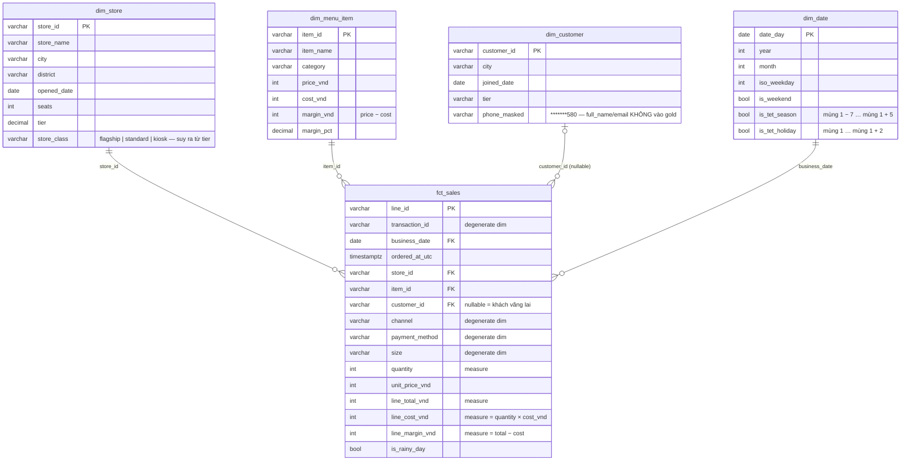

# Lời giải #06 — Star schema cho Phin Phố

## Bước 1 — Grain
**1 dòng `fct_sales` = 1 line item (1 món trong 1 hoá đơn).** Đây là grain nhỏ nhất dữ liệu nguồn có.
Không chọn grain hoá đơn vì câu hỏi có chiều **món**: ở grain hoá đơn, "doanh thu món Bạc xỉu" không tồn tại. Từ grain line item cộng lên hoá đơn/ngày/cửa hàng luôn được (measure additive); chiều ngược lại thì không.

## Bước 2 — ERD


Đối chiếu với dbt: [`platform/dbt/models/marts/`](../../../../platform/dbt/models/marts) có đúng 5 bảng này + `fct_daily_store_revenue` (aggregate table cho dashboard). dbt viết mỗi bảng là một `SELECT` và để engine tạo DDL — nhưng **quyết định thiết kế** (grain, dim nào, measure nào) thì y hệt file bạn vừa viết tay.

## Bước 3 — Trả lời
1. **Degenerate dimension.** `channel`, `payment_method`, `size` không có thuộc tính đi kèm (không có "tên kênh", "phí thanh toán"…). Tạo `dim_channel` 2 dòng chỉ thêm 1 JOIN cho mỗi query. Khi nào tách? Khi thuộc tính xuất hiện — ví dụ `payment_method` có phí % theo cổng thanh toán → lúc đó `dim_payment_method(method, provider, fee_pct)` đáng giá.
2. `is_rainy_day` là thuộc tính của **(ngày, thành phố)**, không phải của hoá đơn. Đúng chuẩn nó thuộc một dim `dim_city_weather(date_day, city, is_rainy)`; để trong fact (như hiện tại) là chấp nhận được vì nó đã bị "denormalize" từ nguồn và chỉ tốn 1 bit/dòng. Để vào `dim_date` là **sai**: cùng 1 ngày Hà Nội mưa, TP.HCM nắng.
3. **SCD type 1** (overwrite) — margin tháng 2 bị tính lại theo giá tháng 3. Muốn giữ lịch sử → **SCD type 2**: thêm `valid_from`, `valid_to`, `is_current` và một **surrogate key** (`menu_item_sk`) để fact trỏ vào *phiên bản* giá đúng thời điểm bán. `snapshots/menu_price_snapshot.sql` của dbt làm đúng việc này: `strategy='check', check_cols=['price_vnd','cost_vnd']` → mỗi lần giá đổi, dbt đóng dòng cũ (`dbt_valid_to`) và mở dòng mới. Cách rẻ hơn cho bài toán này: fact đã lưu `unit_price_vnd` và `line_cost_vnd` **tại thời điểm bán** → margin lịch sử không đổi dù dim bị overwrite. Lưu measure tại thời điểm giao dịch vào fact là cách SCD "miễn phí" phổ biến nhất.
4. **Không đáng.** Snowflake tiết kiệm chỗ khi dim lớn và thuộc tính lặp nhiều (hàng triệu khách × 63 tỉnh). Với 30 dòng, tách thêm 2 bảng chỉ thêm 2 JOIN cho BI tool và làm người đọc mô hình mệt hơn. Snowflake có lý khi nhiều fact dùng chung `dim_city` (doanh thu, marketing, thời tiết) hoặc khi phân cấp cần quản trị riêng (ai được sửa tên quận?).

## Data Vault — chỉ một ví dụ, đủ để nhận ra khi gặp
[`data_vault.sql`](data_vault.sql) mô hình hoá **store** và **machine** theo Data Vault 2.0:

| Loại | Bảng | Chứa gì |
|------|------|---------|
| Hub | `hub_store`, `hub_machine` | chỉ **business key** + hash key + `load_dts` + `record_source`. Không thuộc tính. |
| Link | `link_store_machine` | quan hệ giữa 2 hub (máy nào ở cửa hàng nào). Không thuộc tính. |
| Satellite | `sat_store`, `sat_machine` | mọi thuộc tính mô tả, kèm `load_dts` + `hash_diff` → tự nhiên là SCD2: thuộc tính đổi = thêm dòng sat mới. |

Khi nào dùng: nhiều hệ thống nguồn cùng nói về một thực thể (store trong POS, trong HR, trong hợp đồng thuê mặt bằng) và yêu cầu audit "ai nói gì lúc nào". Star schema vẫn được dựng **phía trên** Data Vault để BI query — Vault là layer tích hợp, không phải layer báo cáo. Với Phin Phố 1 nguồn POS, Vault là quá tay; biết để nhận ra khi JD ghi "Data Vault" hay vào ngân hàng/bảo hiểm.

## Kết quả load (`load_star.py` trên solution)
```
dim_customer      2,000   dim_date 1,095   dim_menu_item 23   dim_store 30
fct_sales         4,302   (= lines_clean 4,302)   txn_clean 2,468
sum(line_total_vnd) = 240 469 000   sum(line_margin_vnd) = 181 623 000
```
`txn_clean` 2 468 = 2 481 − 5 trùng − 8 thiếu store. `fct_sales` 4 302 = 4 328 − 10 `negative_qty` − 16 line của 8 hoá đơn thiếu store.
Revenue fact 240 469 000 < tổng hoá đơn gộp 241 002 000 đúng **533 000** = giá trị 10 line hoàn-hàng-sai bị quarantine (dữ liệu nguồn tính `total_amount_vnd` trước khi flip dấu).
