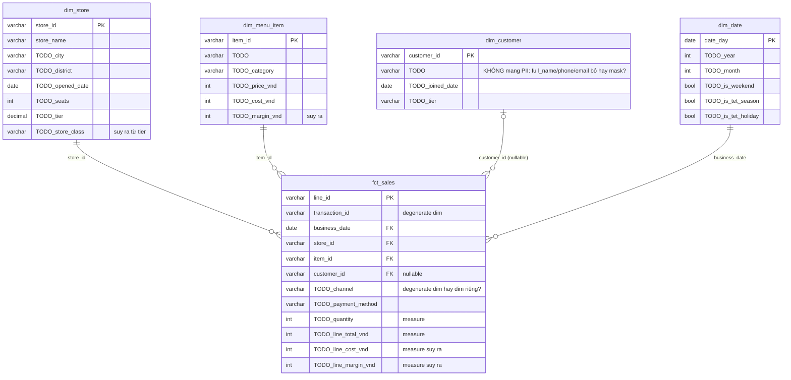

# Lab #06 — Thiết kế star schema cho Phin Phố

Câu hỏi nghiệp vụ cần trả lời: **doanh thu và margin theo ngày × cửa hàng × món × kênh**.

Nguồn: 5 bảng OLTP (`stores`, `menu_items`, `customers`, `pos_transactions`, `pos_line_items`) — xem [SCHEMA.md](../../../data/generator/SCHEMA.md).

## Bước 1 — Quyết định grain
> Grain của fact (1 dòng fact = 1 cái gì?): **TODO**
>
> Vì sao không chọn grain = 1 hoá đơn? **TODO**

## Bước 2 — ERD (Mermaid)
Điền `TODO` trong sơ đồ: thuộc tính của từng dim, measure của fact, và kiểu quan hệ.
Quy ước: `PK` khoá chính, `FK` khoá ngoại. Render tại https://mermaid.live.



## Bước 3 — Trả lời ngắn
1. `channel` chỉ có 2 giá trị (`store`/`app`), `payment_method` có 6. Làm dim riêng hay để trong fact (degenerate dimension)? Vì sao? **TODO**
2. `is_rainy_day` nằm ở `pos_transactions` (SCHEMA.md nói thật ra nó thuộc bảng weather). Trong star schema bạn để nó ở đâu: fact, `dim_date`, hay `dim_store_date` mới? **TODO**
3. Giá `price_vnd` đổi vào 1/3 → `dim_menu_item` hiện tại sẽ **viết lại lịch sử** margin tháng 2. Đây là SCD type gì? Muốn giữ lịch sử thì dim cần thêm cột gì? (Gợi ý: [snapshots/menu_price_snapshot.sql](../../../platform/dbt/snapshots/menu_price_snapshot.sql)) **TODO**
4. Snowflake schema sẽ tách `dim_store` → `dim_store` + `dim_district` + `dim_city`. Với 30 cửa hàng, 15 quận/thành phố, có đáng không? **TODO**

## Bước 4 — Viết DDL
Sang [`star_schema.sql`](star_schema.sql) và điền 9 TODO. Chạy:
```bash
uv run python videos/06-data-modeling/lab/load_star.py videos/06-data-modeling/lab/star_schema.sql
```
