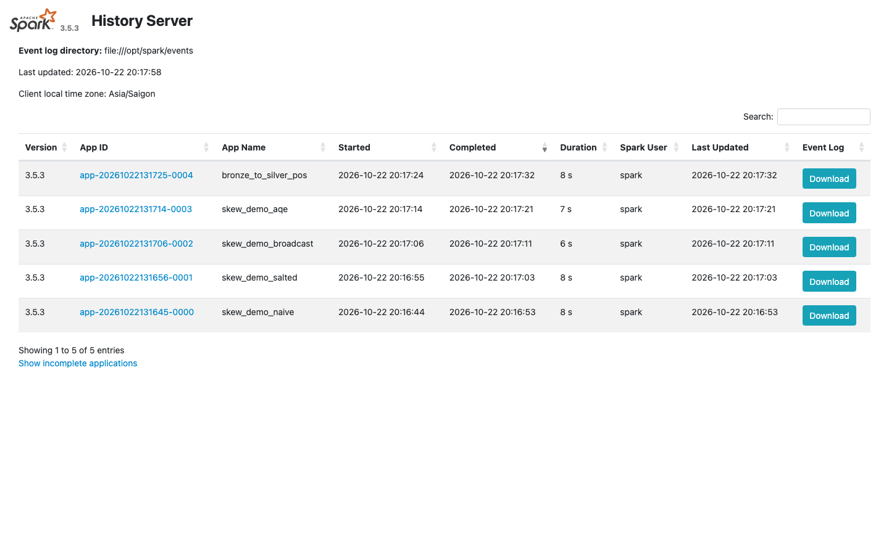
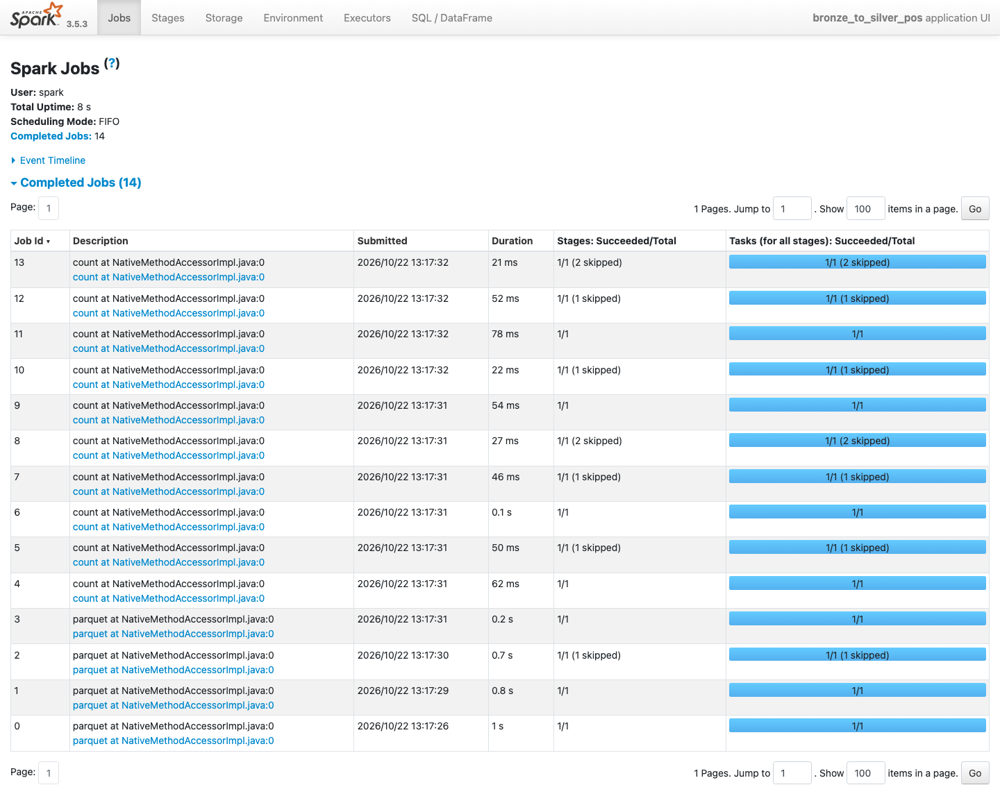
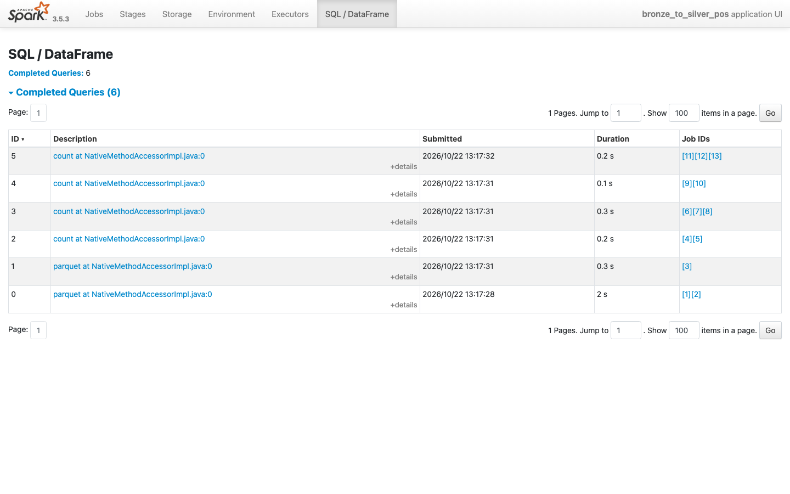
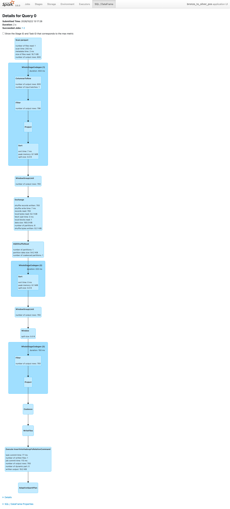

# #10 — Apache Spark từ số 0

📺 Video: `TODO:youtube-link`

## Bạn sẽ học được gì
- Giải thích được 5 từ khoá bằng chính job của repo: **driver / executor / partition / shuffle / lazy evaluation** — và chỉ ra chúng trong Spark UI.
- Đọc hiểu [`platform/spark/bronze_to_silver_pos.py`](../../platform/spark/bronze_to_silver_pos.py): cùng rule dedup / tz_drift / quarantine của video #07 nhưng viết bằng PySpark; biết khi nào Polars là đủ và khi nào cần Spark.
- Chạy `spark-submit` lên cluster Docker, đọc dữ liệu từ MinIO qua `s3a://`, xem jobs → stages → tasks trên Spark UI.
- Viết cùng một phép tính (doanh thu theo cửa hàng) bằng RDD, DataFrame API và Spark SQL, rồi so sánh plan.

## Yêu cầu trước khi xem
- Đã xem #07 (pipeline Python) và #09 — **bronze ngày 15/02 phải có sẵn trên MinIO** (`coffee-ingest run --lake s3://lake --date 2026-02-15`, xem #09 bước 2).
- `make up PROFILE=spark` (postgres + minio + jupyter + spark-master + spark-worker; cần Docker ≥ 6 GB RAM). `make ps` phải thấy `spark-master` healthy. Spark UI: http://localhost:8085.
- Máy 8 GB: bỏ cluster, chạy mọi lệnh ở bước 3–5 trong Jupyter với `--master "local[*]"` và `--lake /home/jovyan/work/lake-local`.

## Lab: pipeline Python của #07, phiên bản Spark

### Bước 1 — Đọc `common.py` (30 dòng)
[`platform/spark/common.py`](../../platform/spark/common.py) có 3 hàm: `build_session` (có `--master` → cluster, không → `local[*]`), `base_parser` (`--lake`, `--date`, `--master`), `layer_path` (ghép `lake/layer/table/dt=...`). Mọi job của khoá dùng chung file này; cấu hình S3A/Iceberg nằm trong [`infra/docker/spark-defaults.conf`](../../infra/docker/spark-defaults.conf) chứ không lặp trong code — mở ra xem `fs.s3a.endpoint = http://minio:9000` và `spark.sql.shuffle.partitions = 8`.

### Bước 2 — Đọc `bronze_to_silver_pos.py` cạnh `silver.py`
Mở hai file song song và nối từng dòng:

| Polars (`coffee_ingestion/silver.py`) | PySpark (`bronze_to_silver_pos.py`) |
|---|---|
| `pl.col(col).str.contains(r"[+-]\d{2}:\d{2}$")` | `F.col(col).rlike(r"[+-]\d{2}:\d{2}$")` |
| `str.to_datetime(time_zone="UTC")` | `F.to_timestamp(...)` + `spark.sql.session.timeZone = UTC` |
| `sort(...).with_columns(pl.int_range(pl.len()).over("transaction_id"))` | `Window.partitionBy("transaction_id").orderBy("ts")` + `row_number()` |
| `df.write_parquet(uri)` (1 file) | `.coalesce(1).write.mode("overwrite").parquet(path)` |

Khác biệt quan trọng không nằm ở syntax: Polars chạy trên **một máy**, Spark chia DataFrame thành **partition** trải trên nhiều executor; `Window.partitionBy("transaction_id")` buộc Spark **shuffle** để gom mọi dòng cùng `transaction_id` về một chỗ. Với 799 dòng việc này là lãng phí; với 500 triệu dòng, đó là lý do Spark tồn tại.

### Bước 3 — spark-submit lên cluster
```bash
docker compose exec spark-master spark-submit --master spark://spark-master:7077 \
  /opt/jobs/bronze_to_silver_pos.py --date 2026-02-15 --lake s3a://lake
```
Để ý: `s3a://` (connector Hadoop của Spark) chứ không phải `s3://` như pyarrow ở #09 — cùng bucket, khác driver. Job đọc `s3a://lake/bronze/pos_transactions/dt=2026-02-15/` và **ghi đè** `silver/pos_transactions/dt=2026-02-15/` (xoá file `part-000.parquet` mà Python đã ghi, thay bằng `part-00000-<uuid>.parquet` + `_SUCCESS`).

### Bước 4 — Spark UI: tìm 5 từ khoá
Ba địa chỉ, đừng nhầm:
- http://localhost:8085 — **Master UI**: cluster có mấy worker, application nào đang/đã chạy. Link "Application Detail UI" ở đây trỏ vào hostname *bên trong* container nên bấm từ máy bạn sẽ không mở được.
- http://localhost:4040 — **Application UI** của job đang chạy (driver nằm trong `spark-master`, compose đã publish port 4040). Chỉ sống khi job chạy; job 11 giây thì bạn không kịp bấm.
- http://localhost:18080 — **History Server** (service `spark-history`, profile `spark`): đọc event log của mọi job đã xong (`spark.eventLog.enabled` bật sẵn trong image). Đây là chỗ bạn soi job sau khi nó chạy xong — và là chỗ chụp các ảnh dưới đây.



Mở http://localhost:18080 → `bronze_to_silver_pos`:
- **Jobs**: mỗi action (`count()`, `write`) là một job — code gọi `count()` 4 lần trong `print(...)` cộng 2 lần `write`, nên bạn đoán 6. Thực tế UI hiện **14 job** (id 0–13): vì AQE bật, mỗi action có shuffle bị tách thành *map-stage job* + job cuối; thêm 1 job đọc schema Parquet. Và vì **lazy**, 4 lần `count()` đọc lại bronze 4 lần (bài tập 1 sửa điều này).
- **Stages**: job có shuffle sẽ tách thành ≥ 2 stage; ranh giới chính là `Exchange` trong plan (do `Window.partitionBy`).
- **Tasks**: mỗi stage có N task = N partition. `spark.sql.shuffle.partitions = 8` nên bạn chờ 8 task sau shuffle — nhưng log thật ghi `Submitting 1 missing tasks from ShuffleMapStage` cho **mọi** stage: AQE (`coalescePartitions`) thấy 8 partition shuffle chỉ vài KB nên gộp thành 1. Tắt AQE (`--conf spark.sql.adaptive.enabled=false`) sẽ thấy đúng 8 task. Đây là ví dụ đầu tiên cho #11: config bạn đặt là *gợi ý*, AQE quyết định lúc chạy.
- **Executors**: 1 driver + 1 executor (worker 2 core, 2 GB) — driver lập kế hoạch, executor làm việc.
- **SQL / DataFrame** tab: bấm vào query → DAG có `Scan parquet` → `Filter` → `Exchange` → `Sort` → `Window` → ... Đây là physical plan sau Catalyst.

### Bước 5 — Lab: word count → doanh thu theo cửa hàng
Mở [`lab/wordcount_to_revenue.py`](lab/wordcount_to_revenue.py), điền 6 TODO: viết cùng phép tính bằng RDD (`map` + `reduceByKey`), DataFrame API (`groupBy().agg()`), Spark SQL — rồi assert 3 kết quả khớp. Chạy trong Jupyter (http://localhost:8888, token `dea2z`) → New → Terminal:
```bash
# cần lake-local trên máy host (make smoke) — Jupyter mount repo tại /home/jovyan/work
python work/videos/10-apache-spark/lab/wordcount_to_revenue.py --lake /home/jovyan/work/lake-local --date 2026-02-15
```
Hoặc chạy trên MinIO: `--lake s3a://lake`. Lời giải: [`lab/solution/wordcount_to_revenue.py`](lab/solution/wordcount_to_revenue.py). Trong `explain()` hãy tìm `HashAggregate` xuất hiện **hai lần** (partial trước shuffle, final sau shuffle) — đây là tối ưu mà RDD `reduceByKey` phải tự làm, còn Catalyst làm hộ bạn.

**Không có test offline cho video này**: `.venv` không có pyspark (cố ý — pyspark + JVM nặng 300 MB). Mọi lệnh chạy trong Docker.

## Kết quả mong đợi
- Bước 3 (chạy thật trên cluster compose, worker 2 core/2 GB): toàn bộ `spark-submit` mất **11 giây**, trong đó khởi động SparkContext + xin executor ~4 s. Dòng cuối (sau hàng trăm dòng INFO):
  ```
  bronze=799 silver=792 quarantine=4 tz_fixed=5
  ```
  — cùng số với pipeline Python ở #07: cùng rule, cùng dữ liệu, hai engine. Vài dòng log đáng đọc:
  ```
  INFO SparkContext: Running Spark version 3.5.3
  INFO StandaloneSchedulerBackend: Granted executor ID app-20261022114346-0000/0 on hostPort 172.25.0.5:33799 with 2 core(s)
  INFO DAGScheduler: Job 0 finished: parquet at NativeMethodAccessorImpl.java:0, took 1.116054 s
  INFO DAGScheduler: Registering RDD 6 (parquet ...) as input to shuffle 0
  INFO DAGScheduler: Submitting 1 missing tasks from ShuffleMapStage 1
  INFO DAGScheduler: Job 13 finished: count at NativeMethodAccessorImpl.java:0, took 0.050872 s
  ```
- Spark UI (History Server, http://localhost:18080): application `bronze_to_silver_pos`, **14 job**, 7 shuffle (`shuffle 0`–`6`), mỗi stage **1 task** (AQE gộp), 1 executor 2 core.

  

  Tab **SQL / DataFrame**: mỗi action một query; bấm vào query ghi silver để thấy DAG `Scan parquet → Filter → Exchange → Sort → Window → … → WriteFiles`:

  
  
- Nếu bronze trên MinIO do Airflow (#19) nạp **từ Postgres** thay vì CSV, dòng cuối là `bronze=800 silver=793 quarantine=4 tz_fixed=0` — cùng rule, nguồn khác một dòng (xem #19 vì sao).
- Bước 5, ngày 15/02: `rows=792`, 3 cách đều ra **30 cửa hàng**, tổng **76 939 000 VND**; top 5 giống nhau ở cả 3 cách:

```
SG14     4,776,000
SG04     3,607,000
SG08     3,455,000
HN08     3,452,000
SG13     3,342,000
```
  Dòng cuối: `OK: 30 stores, total revenue 76,939,000 VND (3 cách khớp nhau)`. Số `partitions=` khi đọc 1 file 15 KB là **1**.

## Câu hỏi phỏng vấn của video
> "Job Spark của bạn có 200 task, 199 task xong trong 10 giây, 1 task chạy 20 phút. Bạn mở tab nào trong Spark UI trước, nhìn cột gì, và đoán nguyên nhân gì? (Video #11 trả lời bằng code.)"

Trả lời dưới comment video — mình sẽ ghim câu trả lời hay nhất.

## Bài tập
1. `bronze_to_silver_pos.py` gọi `count()` 4 lần → đọc bronze 4 lần. Sửa (trong bản copy của bạn, không sửa `platform/`) bằng `cache()` hoặc gom thành 1 `agg`, chạy lại và so số job trên Spark UI trước/sau. Dán 2 con số dưới comment.
2. Viết cách thứ 4 cho lab bước 5 bằng **Polars** trên cùng file Parquet (chạy được trên host, không cần Spark). Với 792 dòng, cách nào nhanh nhất? Theo bạn tới bao nhiêu GB thì Spark mới đáng?
3. (Discussion) Đổi `spark.sql.shuffle.partitions` từ 8 thành 200 (mặc định của Spark) rồi chạy lại bước 3. Số task thay đổi thế nào, thời gian thì sao? Vì sao mặc định 200 lại tệ cho dữ liệu nhỏ — và vì sao vẫn là mặc định?
