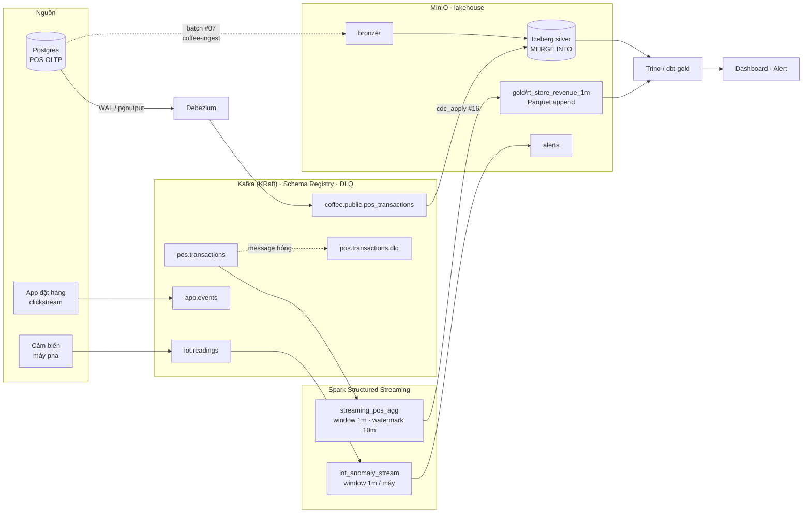

# #18 — Kiến trúc streaming end-to-end

📺 Video: `TODO:youtube-link` · 📑 Slide: [V18-Streaming-end-to-end.pdf](slides/V18-Streaming-end-to-end.pdf)

## Bạn sẽ học được gì
- Ghép 5 video trước thành **một** hệ thống chạy thật: POS → Debezium → Kafka → Spark Streaming → Iceberg/Parquet → Trino/dbt; app events và IoT đi cùng đường.
- Chạy toàn bộ bằng `PROFILE=all` theo một **runbook** có lệnh kiểm chứng từng bước — kỹ năng vận hành mà demo slide không dạy.
- **Đo** độ trễ end-to-end thay vì tin vào chữ "real-time": từ lúc message vào Kafka tới lúc nó xuất hiện ở sink.
- Phân biệt Lambda và Kappa, và trả lời thẳng: chuỗi cà phê 30 cửa hàng **có cần streaming không**.

## Yêu cầu trước khi xem
- Đã làm lab #13–#17. Đây là video tổng hợp, không có khái niệm mới ngoài Lambda/Kappa.
- Máy 16 GB RAM, Docker được cấp ≥ 10 GB: `make up PROFILE=all`. Máy 8–12 GB: chạy runbook theo nhóm (streaming + spark trước, analytics sau), bỏ qua Airflow/Marquez.
- Lab không có test offline — toàn bộ cần Docker.

## Sơ đồ toàn hệ thống


Hai đường vào silver cùng tồn tại: **batch** (coffee-ingest mỗi đêm, #07) và **CDC** (Debezium, #16). Trong lab #16 bạn đã thấy chúng cho cùng kết quả cuối; khác nhau ở độ trễ và chi phí vận hành — đó là chủ đề của phần "Lambda vs Kappa" bên dưới.

## Lab: chạy cả hệ thống theo runbook

### Bước 1 — Điền runbook
Mở [`lab/runbook.md`](lab/runbook.md). Mỗi bước có **mục tiêu** và chỗ trống cho **lệnh** + **lệnh kiểm chứng** (bạn đã gõ hết ở #13–#17, giờ xếp lại đúng thứ tự phụ thuộc). Thứ tự quan trọng: Spark job `startingOffsets=latest` phải bật **trước** producer; Debezium cần `REPLICA IDENTITY` trước khi UPDATE; sink Parquet cần checkpoint trên S3 để restart không ghi trùng.

### Bước 2 — Chạy theo runbook
```bash
make up PROFILE=all && make ps
```
Rồi đi từng bước trong runbook của bạn (đối chiếu [`lab/solution/runbook.md`](lab/solution/runbook.md) khi kẹt). Điểm đến: thư mục `s3a://lake/gold/rt_store_revenue_1m/` có file Parquet mới xuất hiện mỗi khi một cửa sổ 1 phút đóng.

### Bước 3 — Đo độ trễ end-to-end
Message POS không có `ingested_at`, nhưng Kafka gắn **timestamp lúc message vào broker** cho mỗi record — mình dùng nó làm "ingested_at". Sink Parquet có `LastModified` của từng object trên MinIO. Latency của một cửa sổ = `LastModified(file chứa cửa sổ) − max(Kafka timestamp của các message trong cửa sổ đó)`.

Mở [`lab/latency_probe.py`](lab/latency_probe.py), điền 3 TODO (khoá cửa sổ từ `ts`, luồng tap Kafka, ghép file Parquet mới với tap). Chạy trong container Jupyter (có `confluent-kafka` + `boto3` + `duckdb`), trong lúc producer và Spark job (sink parquet) đang chạy:
```bash
docker compose exec jupyter python /home/jovyan/work/videos/18-kien-truc-streaming-end-to-end/lab/latency_probe.py \
  --bootstrap kafka:29092 --s3-endpoint http://minio:9000 --duration 240
```
Từ máy host: `uv run --with confluent-kafka --with boto3 python videos/18-kien-truc-streaming-end-to-end/lab/latency_probe.py --duration 240` (mặc định `localhost:9092`, `http://localhost:9000`).

Nó in mỗi file Parquet mới: số cửa sổ, số cửa sổ khớp được với tap, p50/p95 latency; cuối cùng là tổng kết.

### Bước 4 — Đọc gold từ Trino / DuckDB
```bash
docker compose exec trino trino --execute "SELECT * FROM lake.silver.pos_transactions LIMIT 3"   # nếu catalog Iceberg hoạt động (#17 bước 5)
uv run python -c "
import duckdb; c = duckdb.connect()
c.sql(\"INSTALL httpfs; LOAD httpfs; SET s3_endpoint='localhost:9000'; SET s3_use_ssl=false; SET s3_url_style='path'; SET s3_access_key_id='minioadmin'; SET s3_secret_access_key='minioadmin'\")
print(c.sql(\"SELECT store_id, sum(revenue_vnd) FROM read_parquet('s3://lake/gold/rt_store_revenue_1m/*.parquet') GROUP BY 1 ORDER BY 2 DESC LIMIT 5\"))"
```

### Bước 5 — Dọn
Theo mục cuối runbook: xoá connector + slot, dừng job, `make down`.

## Lambda, Kappa, và câu hỏi thật
**Lambda** (2011, Nathan Marz): hai đường song song — batch cho kết quả đúng, speed layer cho kết quả nhanh — rồi hợp nhất ở serving. Giá: viết logic **hai lần**, hai hệ thống để vận hành, hai nguồn sai số.
**Kappa** (2014, Jay Kreps): chỉ một đường streaming; cần tính lại thì replay log từ đầu. Giá: Kafka giữ dữ liệu lâu (hoặc tiered storage), mọi thứ phải là stream, backfill chậm hơn batch.
Năm 2026 thực tế là **lai**: table format (Iceberg/Delta) làm sink chung, batch và streaming cùng ghi vào một bảng bằng `MERGE` — chính là sơ đồ ở trên. Logic nghiệp vụ viết một lần trong dbt/SQL trên bảng đó.

**Phin Phố 30 cửa hàng cần gì?** Làm phép tính: 30 cửa hàng × ~800 hoá đơn/ngày ≈ 24 000 hoá đơn/ngày ≈ **0,3 message/giây** (giờ cao điểm ~2/giây). Doanh thu theo ngày cho kế toán: batch 1 lần/đêm là đủ và đúng hơn (hoàn tiền, huỷ đơn kịp vào). Dashboard quản lý vùng xem giờ cao điểm: micro-batch **mỗi 15 phút** từ Postgres bằng `coffee-ingest` là thừa đủ, zero Kafka. Chỗ streaming đáng tiền duy nhất: **cảnh báo máy pha** (boiler > 95,5 °C hay áp suất tụt → máy hỏng = cửa hàng ngừng bán trong 2 ngày), và có thể **chống gian lận voucher** trên app theo phiên. CDC đáng tiền khi Postgres POS quá tải vì full-load hoặc khi cần bắt **DELETE** (huỷ hoá đơn) mà bảng không có `deleted_at`.

| Nhu cầu | Độ trễ cần | Cách rẻ nhất đạt được |
|---------|-----------|------------------------|
| Báo cáo doanh thu ngày | T+1 | batch đêm (#07, #19) |
| Dashboard vùng trong ngày | 15 phút | batch tăng dần theo `loaded_at` |
| Cảnh báo máy pha | < 1 phút | Kafka + Structured Streaming (#15) |
| Đồng bộ POS → lake không tải DB | phút | CDC (#16) |
| "Real-time" vì khách hàng muốn nghe | — | hỏi lại họ cần quyết định gì trong bao lâu |

Streaming không sai; sai là trả chi phí vận hành 24/7 (broker, checkpoint, watermark, schema, DLQ, on-call) cho dữ liệu mà người dùng chỉ xem mỗi sáng.

## Kết quả mong đợi
- `make ps`: ~20 container, tất cả `healthy`/`running` sau 3–5 phút (Airflow và Trino lên chậm nhất).
- Runbook chạy trọn: topic `coffee.public.pos_transactions` có snapshot, `pos.transactions` nhận producer, `s3a://lake/gold/rt_store_revenue_1m/` có file Parquet mới mỗi ~10–30 giây khi producer chạy `--rate 20` (cửa sổ 1 phút event-time đóng rất nhanh vì event time chạy nhanh hơn đồng hồ ~1 700 lần).
- `latency_probe.py` (đo thật, producer `--rate 20`, probe `--duration 120`):
  ```
  tap pos.transactions @ localhost:9092; theo dõi s3://lake/gold/rt_store_revenue_1m/
  12:22:12  part-00004-e2967510-…  windows= 16 matched=  4 p50=   2.5s p95=   2.9s
  12:22:12  part-00006-7aff36e8-…  windows= 13 matched=  6 p50=   2.4s p95=   3.1s
  12:23:15  part-00001-0b2d6bfb-…  windows= 17 matched= 16 p50=  43.2s p95=  45.5s
  12:23:16  part-00000-082d960f-…  windows= 59 matched= 59 p50=  27.2s p95=  38.0s
  ...
  565 cửa sổ đo được
  end-to-end latency  p50=31.6s  p95=44.8s  max=61.4s
  Phần lớn con số này là watermark (10 phút event-time) + micro-batch, không phải Kafka hay Spark 'chậm'.
  ```
  Đọc kết quả: file đầu ra **theo đợt** (12:22:12 rồi 12:23:15 — cách nhau một phút), mỗi đợt 8 file (`spark.sql.shuffle.partitions = 8`, mỗi partition một file — small files bằng xương bằng thịt, nối với #11). Cửa sổ chỉ được ghi khi watermark vượt `window.end` + 10 phút event-time; với event time trôi nhanh ~1 700× thì 10 phút ≈ 0,35 s thật, nên phần lớn latency là **chờ đủ dữ liệu cho micro-batch kế tiếp** đóng cửa sổ, không phải tính toán. Đợt đầu p50 2,5 s; các đợt sau 27–44 s vì ở `--rate 20` một cửa sổ 1 phút event-time cần ~3 s thật để qua, và watermark chỉ nhích khi batch mới tới. **Latency của append-mode sink do watermark và nhịp dữ liệu quyết định, không phải do Kafka hay Spark chậm.**
- `make ps` lúc chạy trọn runbook: 17 container (xem bảng ở #05), tất cả `healthy`/`running`; Airflow và Trino lên chậm nhất (~1 phút). `mc ls --recursive local/lake/gold/rt_store_revenue_1m/` sau 2 phút: 35 object (28 Parquet + 7 file `_spark_metadata/N`, mỗi batch có output một file metadata — đó là cách Spark làm sink file *exactly-once*: reader chỉ tin file được liệt kê trong `_spark_metadata`).
- DuckDB đọc được gold từ MinIO: `624 cửa sổ, 644 orders` sau 2 phút (phần còn lại chưa đóng); top cửa hàng `SG14 34 orders 4 165 000` → `SG04` → `SG09` — khớp với console sink ở #15 (SG14 dẫn đầu ngày 15/02).

## Câu hỏi phỏng vấn của video
> "Khách hàng là chuỗi 30 cửa hàng, yêu cầu 'dashboard real-time'. Bạn có 3 tháng và 2 kỹ sư. Bạn đề xuất kiến trúc gì, chỗ nào dùng streaming, chỗ nào kiên quyết không, và bạn đo cái gì để chứng minh lựa chọn đó đúng sau khi go-live?"

Trả lời dưới comment video — mình sẽ ghim câu trả lời hay nhất.

## Bài tập
1. Thêm vào runbook một mục **"Sự cố"**: Debezium chết 1 giờ, Spark job chết 1 giờ, MinIO đầy đĩa. Với mỗi sự cố: triệu chứng ở đâu, lệnh kiểm tra, cách khôi phục không mất/không trùng dữ liệu.
2. Chạy lại `latency_probe.py` với producer `--rate 2` (event time trôi chậm hơn 10 lần). p50 thay đổi thế nào? Giải thích bằng watermark. Rồi đổi job sang `--sink console` với `outputMode("update")`: latency còn phụ thuộc watermark không?
3. Viết một trang "Quyết định kiến trúc" (ADR, ≤ 1 trang) cho Phin Phố: chọn batch 15 phút cho dashboard và streaming chỉ cho IoT. Nêu 3 điều kiện khiến bạn đổi quyết định sau 1 năm. Mở Discussion để mọi người phản biện.
