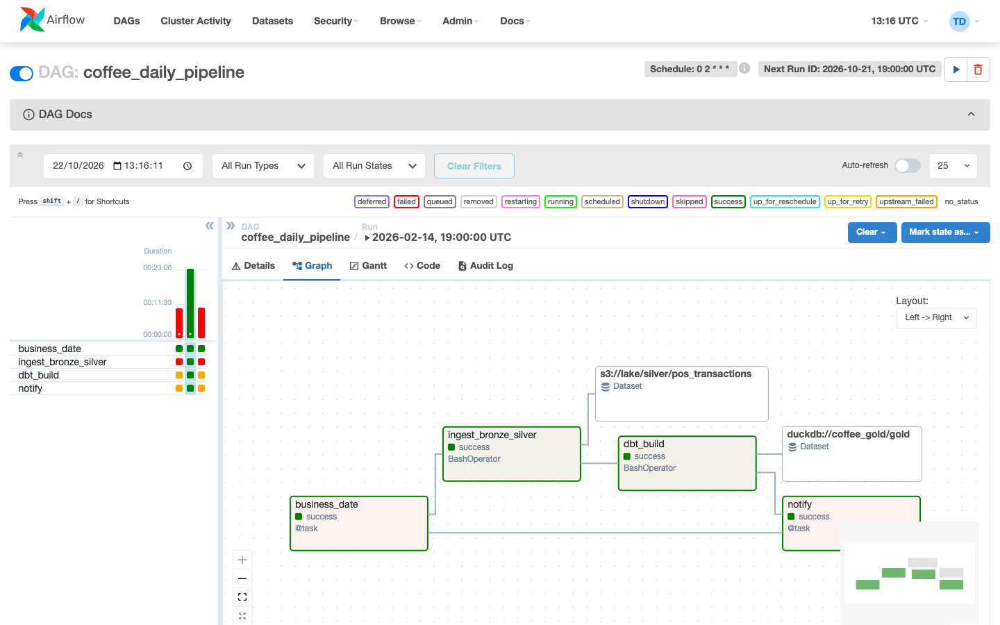

# #19 — Airflow

📺 Video: `TODO:youtube-link` · 📑 Slide: [V19-Apache-Airflow-tu-so-0.pdf](slides/V19-Apache-Airflow-tu-so-0.pdf)

## Bạn sẽ học được gì
- Hiểu Airflow làm gì và **không** làm gì: nó lên lịch và theo dõi, không xử lý dữ liệu. Mọi task trong repo chỉ gọi đúng CLI bạn đã chạy tay ở video #07 và #12.
- Đọc hiểu 3 DAG của dự án Phin Phố (`coffee_daily_pipeline`, `coffee_backfill`, `coffee_quality_checks`): TaskFlow `@task`, `BashOperator`, `Dataset`, `params`, `retries`, `catchup`.
- Hiểu vì sao task phải **idempotent** và vì sao dùng `{{ ds }}` thay cho `datetime.now()`.
- Tự viết một DAG mới (`coffee_weekly_report`) và đưa vào Airflow đang chạy.
- Backfill đúng cách: chạy lại một khoảng ngày mà không tạo bản ghi trùng.

## Yêu cầu trước khi xem
- Đã xem #07 (pipeline bronze/silver) và #12 (dbt) — DAG chỉ nối hai thứ đó lại.
- Service: `make up PROFILE=all` (máy ≥ 16 GB RAM). Máy 8–12 GB: `make down` rồi `make up PROFILE=orchestration` (core + airflow + marquez, ~5 GB). Chờ `make ps` thấy `airflow-webserver` **healthy** (lần đầu build image ~5–8 phút).
- Mở http://localhost:8082, đăng nhập `admin` / `admin`.

## Lab: chạy, đọc, viết DAG

### Bước 1 — Bật và chạy `coffee_daily_pipeline`
Trong UI: tìm DAG `coffee_daily_pipeline` → bật toggle bên trái → bấm ▶ **Trigger DAG**. Mở tab **Graph** để xem 4 task nối nhau: `business_date → ingest_bronze_silver → dbt_build → notify`.

Hoặc bằng CLI. **Chọn ngày**: Postgres chỉ có dữ liệu 14–19/02/2026, nên trigger "bây giờ" sẽ nạp ngày hôm qua (rỗng) và `ingest` thoát mã 2 — đúng hành vi của `coffee-ingest` khi silver trống. Truyền logical date là **02:00 ngày D+1 giờ VN** để nạp ngày D:
```bash
docker compose exec airflow-webserver airflow dags trigger coffee_daily_pipeline -e "2026-02-16T02:00:00+07:00"   # nạp 2026-02-15
docker compose exec airflow-webserver airflow dags list-runs -d coffee_daily_pipeline
```
Vì sao không dùng `{{ ds }}` thẳng? `ds` là ngày của `logical_date` tính theo **UTC**: lịch `0 2 * * *` giờ VN = 19:00 UTC hôm trước, nên `ds` lệch đúng một ngày (run cho 15/02 có `ds = 2026-02-14`). Task `business_date` đổi `data_interval_start` về `Asia/Ho_Chi_Minh` rồi mới lấy ngày; `ingest` nhận ngày đó qua XCom. Mình chỉ phát hiện lỗi này khi chạy thật — Airflow không báo gì, chỉ có dữ liệu sai ngày.

Bật toggle DAG lần đầu, Airflow sẽ tự tạo **một run** cho data interval gần nhất (hôm qua) dù `catchup=False` — run đó fail ở `ingest` (không có dữ liệu). Không phải bug; đó là lý do bước 3 nói về `catchup`.

Bấm vào ô `ingest_bronze_silver` → **Log**. Bạn sẽ thấy đúng JSON summary mà `coffee-ingest run` in ra ở video #07, chỉ khác `--source` là Postgres và `--lake` là `s3://lake` (MinIO).

### Bước 2 — Backfill một khoảng ngày bằng config JSON
```bash
docker compose exec airflow-webserver airflow dags trigger coffee_backfill \
  --conf '{"start": "2026-02-14", "end": "2026-02-17"}'
```
Trong UI mở **Grid** của `coffee_backfill`: task `ingest` được **expand** thành 4 task instance (dynamic task mapping), chạy **tuần tự** vì `max_active_tis_per_dag=1`. Kiểm tra trên MinIO (http://localhost:9001 → bucket `lake` → `silver/pos_transactions/`): có 4 thư mục `dt=...`.

Chạy lại lệnh trên lần nữa → số file trong mỗi partition **không tăng**. Đó là idempotency: cùng `--date` → ghi đè cùng partition.

### Bước 3 — Đọc code DAG (10 phút, đọc từng dòng)
Mở [`platform/airflow/dags/coffee_daily_pipeline.py`](../../platform/airflow/dags/coffee_daily_pipeline.py). Những chỗ đáng dừng lại:

| Dòng | Khái niệm | Vì sao |
|------|-----------|--------|
| `schedule="0 2 * * *"` | cron, giờ VN qua `tz=VN` | 02:00 POS đã đóng ca, dữ liệu hôm trước đủ |
| `catchup=False` | không tự chạy bù các ngày quá khứ khi bật DAG | backfill phải là quyết định có chủ đích → DAG riêng |
| `--date {{ ds }}` | Jinja template, `ds` = ngày đầu data interval | DAG chạy 02:00 ngày D+1 nạp dữ liệu ngày D; chạy lại lúc nào cũng ra cùng kết quả |
| `retries: 2, retry_delay: 5 min` | `default_args` | MinIO/Postgres chớp nhả → thử lại, không gọi người |
| `outlets=[SILVER_POS]` | `Dataset` | `coffee_quality_checks` có `schedule=[SILVER_POS]` → chạy khi silver cập nhật, không cần cron thứ hai |
| `max_active_runs=1` | | hai run cùng ghi một partition = race condition |
| `@task def business_date(ds=None)` | TaskFlow | Python thuần, Airflow tự truyền context theo tên tham số |

Anti-pattern cần nhớ: `datetime.now()` trong DAG. Chạy lại task hôm qua sẽ nạp dữ liệu hôm nay — backfill vô nghĩa. Test ở bước 5 bắt lỗi này.

### Bước 4 — Viết DAG mới: báo cáo tuần
Mở [`lab/dags/coffee_weekly_report.py`](lab/dags/coffee_weekly_report.py) và điền 3 TODO:
1. `schedule`: cron chạy **thứ Hai 03:00 giờ VN** (sau daily pipeline).
2. `top_stores`: đọc gold DuckDB (`main_gold.fct_daily_store_revenue`), tính top 5 cửa hàng theo doanh thu trong data interval.
3. `print_report`: in bảng ra log.

Chỉ dùng `@task` Python + `duckdb` (có sẵn trong image Airflow), không cần provider nào. Thử SQL trước ở ngoài Airflow cho nhanh (DuckDB file do `dbt build` ở video #12 tạo):
```bash
uv run python videos/19-airflow/lab/solution/query_top_stores.py --start 2026-02-14 --end 2026-02-18
```

Xong thì copy vào thư mục DAG — Airflow quét lại sau ~30 giây:
```bash
cp videos/19-airflow/lab/dags/coffee_weekly_report.py platform/airflow/dags/
docker compose exec airflow-webserver airflow dags list | grep weekly
docker compose exec airflow-webserver airflow dags trigger coffee_weekly_report
```
(Đừng commit file copy vào `platform/airflow/dags/` — lời giải nằm ở `lab/solution/`.)

### Bước 5 — Test DAG mà không cần cài Airflow
`.venv` của repo không có `airflow` (nặng 500 MB), nên test không import DAG mà **parse file bằng `ast`**:
```bash
uv run pytest videos/19-airflow -q
```
Test kiểm tra: có `dag_id`, có `schedule`, có `tags`, và **không** có `datetime.now()` trong bất kỳ DAG nào của repo. Test "thật" với `DagBag` nằm ở [`platform/airflow/dags/test_dag_integrity.py`](../../platform/airflow/dags/test_dag_integrity.py), chạy trong container (image đã có pytest; `.airflowignore` giữ cho scheduler không parse file test):
```bash
docker compose exec airflow-webserver python -m pytest /opt/airflow/dags -q    # 1 passed, ~60 s (DagBag import thật)
```

## Kết quả mong đợi


- Bước 1 (run `manual__2026-02-16T02:00:00+07:00`, chạy thật): 4 task `business_date → ingest_bronze_silver → dbt_build → notify` đều **success**. `business_date` trả `2026-02-15`. Log `ingest_bronze_silver` là JSON summary của `coffee-ingest`: `pos_transactions` **rows_out = 793, quarantined = 4** — khác CSV (792) đúng 1 dòng: `HN07-20260214-00014` thiếu offset nên Postgres đã lưu thành 04:06 ngày 15 (bài #03), từ Postgres nó thuộc ngày 15. `_tz_fixed` toàn `false` vì Postgres luôn trả chuỗi có offset — lỗi tz_drift ở nguồn này "biến mất" nhưng dữ liệu vẫn sai 7 giờ. `dbt_build`: `Done. PASS=45 WARN=0 ERROR=0 SKIP=0 TOTAL=45`. `notify`: `✅ coffee_daily_pipeline xong cho ngày 2026-02-15` rồi `no SLACK_WEBHOOK_URL / TELEGRAM_* Variable set → log only` — đặt Variable trong Admin → Variables để gửi thật.
- Bước 2: Grid có `ingest [4]`, 4 task instance success (ảnh: [img/airflow-grid-backfill.png](img/airflow-grid-backfill.png); run đỏ bên trái là 2 lần mình chạy khi image Airflow còn thiếu `coffee_ingestion` — giữ lại cho thật); MinIO có `dt=2026-02-14 … dt=2026-02-17`, mỗi thư mục đúng **1 file** `part-000.parquet` kể cả sau khi chạy lại. Số dòng silver từ Postgres: 765 / 793 / 730 / 59 (CSV: 766 / 792 / 730 / 59); quarantine 3 / 4 / 1 / 0 — giống CSV.
- Trang DAGs (ảnh: [img/airflow-home.png](img/airflow-home.png)) và grid của `coffee_quality_checks` ([img/airflow-grid-quality.png](img/airflow-grid-quality.png)).
- `coffee_quality_checks` được Dataset `s3://lake/silver/pos_transactions` kích hoạt ngay sau `ingest_bronze_silver`; cả 4 task success, `business_date` lấy `2026-02-15` từ XCom của run upstream. Trigger tay: `airflow dags trigger coffee_quality_checks --conf '{"date": "2026-02-15"}'`.
- Bước 4: với gold có đủ 14→17/02 (chạy backfill ở bước 2, hoặc `make smoke` + `coffee-ingest run --date` cho 3 ngày còn lại rồi `dbt build`), log `print_report` in:

  | # | store_id | revenue_vnd | transactions |
  |---|----------|-------------|--------------|
  | 1 | SG14 | 12.647.000 | 123 |
  | 2 | SG04 | 11.789.000 | 118 |
  | 3 | HN08 | 10.672.000 | 101 |
  | 4 | SG06 | 10.146.000 | 109 |
  | 5 | SG09 | 10.031.000 | 109 |

  Nếu gold chỉ có ngày 15/02 (chỉ `make smoke`): SG14 4.776.000 · SG04 3.607.000 · SG08 3.455.000 · HN08 3.452.000 · SG13 3.342.000.
- Bước 5: `10 passed` (4 file DAG × 2 test + 2 test riêng cho DAG tuần; test cuối `skipped` nếu chưa có `platform/dbt/target/coffee_gold.duckdb`).

Lỗi hay gặp: DAG không hiện → xem **Import Errors** ở đầu trang UI, hoặc `docker compose exec airflow-webserver airflow dags list-import-errors`. Task đỏ với `No module named duckdb` → bạn đang dùng image Airflow gốc, hãy `docker compose build airflow-init`.

## Câu hỏi phỏng vấn của video
> "Pipeline hằng ngày của bạn fail lúc 02:00, 06:00 sáng bạn fix xong bug. Bạn chạy lại thế nào để không có bản ghi trùng, và `{{ ds }}` lúc đó có giá trị gì? Nếu DAG dùng `datetime.now()` thì chuyện gì xảy ra?"

Trả lời dưới comment video — mình sẽ ghim câu trả lời hay nhất.

## Bài tập
1. Thêm `sla=timedelta(hours=1)` cho `ingest_bronze_silver` và một `on_failure_callback` in ra tên task fail. Mô tả bạn sẽ nối nó vào Slack/Telegram ở đâu (chưa cần code gửi).
2. Đổi `coffee_weekly_report` thành **Dataset-triggered**: chạy khi `GOLD` (`duckdb://coffee_gold/gold`) được cập nhật thay vì cron. Nó sẽ chạy bao nhiêu lần một tuần? Có hợp lý không?
3. `coffee_backfill` chạy tuần tự 4 ngày. Nếu bỏ `max_active_tis_per_dag=1` thì nhanh hơn, nhưng rủi ro gì với MinIO và với `dbt_build` ở DAG kia? Trả lời dưới comment / mở Discussion.
