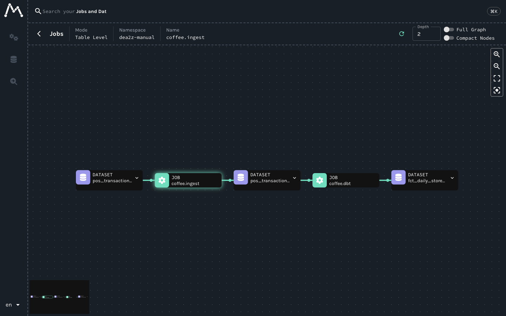
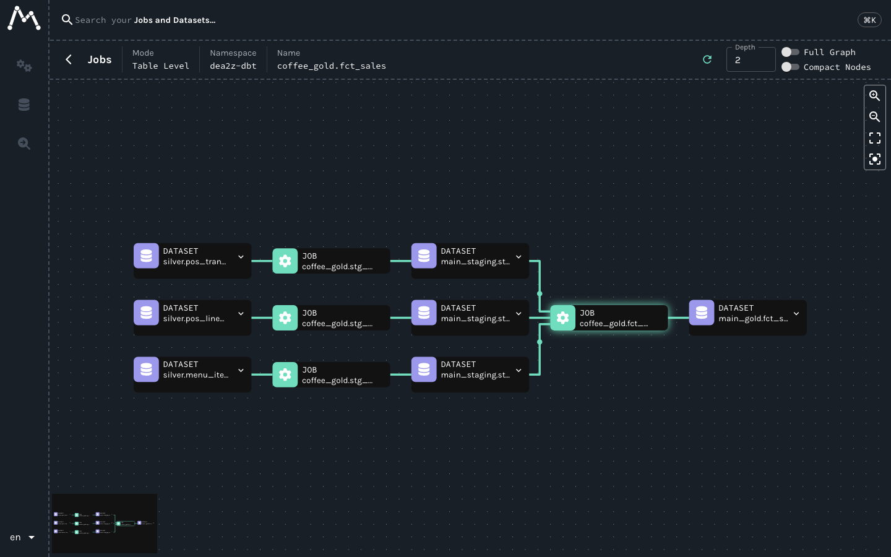

# #21 — Observability & Lineage: OpenLineage, Marquez

📺 Video: `TODO:youtube-link`

## Bạn sẽ học được gì
- Ba trụ observability (**logs / metrics / traces**) áp vào data pipeline, và trụ thứ tư riêng của data: **lineage**.
- Đọc một OpenLineage `RunEvent` (START/COMPLETE, job, run, inputs/outputs) và gửi tay bằng HTTP tới Marquez.
- Thấy lineage tự sinh từ Airflow (provider openlineage đã cấu hình trong compose) và từ dbt (`dbt-ol`).
- Biến JSON summary của `coffee-ingest` thành metric dạng **Prometheus text** để scrape được.
- Hiểu freshness SLA và nguyên tắc alerting: cảnh báo theo **triệu chứng** người dùng thấy, không theo từng task.

## Yêu cầu trước khi xem
- Đã xem #19 (Airflow) — lineage tự động sinh từ các DAG đó.
- Bước 1–3 cần `make up PROFILE=all` (hoặc `PROFILE=orchestration`); Marquez UI http://localhost:3000, API http://localhost:5050.
- Bước 4–5 chạy **offline**, không cần Docker.

## Lab: nhìn thấy pipeline đang làm gì

### Bước 1 — Gửi một RunEvent bằng tay
Đọc [`emit_lineage.py`](../../platform/observability/emit_lineage.py) (stdlib, 60 dòng) rồi chạy:
```bash
uv run python platform/observability/emit_lineage.py --job coffee.ingest \
  --input postgres://coffee_pos/pos_transactions \
  --output s3://lake/silver/pos_transactions
```
Mở http://localhost:3000 → namespace `dea2z-manual` → job `coffee.ingest`: 1 node job, 1 input, 1 output. Chạy lại lệnh với `--job coffee.dbt --input s3://lake/silver/pos_transactions --output duckdb://coffee_gold/fct_daily_store_revenue` → hai job **nối nhau** qua dataset chung. Lineage chỉ là vậy: job + dataset + cạnh, cộng dồn theo thời gian.

Hãy nhìn JSON gửi đi (thêm `print(json.dumps(payload, indent=2))` vào `post()`): `eventType`, `eventTime`, `run.runId` (cùng một UUID cho START và COMPLETE), `job.{namespace,name}`, `inputs[]`, `outputs[]`, `producer`, `schemaURL`.

### Bước 2 — Lineage tự động từ Airflow
Trigger `coffee_daily_pipeline` (như #19). Compose đã đặt `AIRFLOW__OPENLINEAGE__TRANSPORT` trỏ tới `marquez-api:5000` và namespace `dea2z`. Sau khi DAG xong, Marquez có namespace `dea2z` với job `coffee_daily_pipeline.ingest_bronze_silver` và `coffee_daily_pipeline.dbt_build`.

Lưu ý thật: `BashOperator` **không tự biết** input/output của lệnh shell — provider chỉ gửi job + run, không có dataset. Đó là lý do DAG khai báo `outlets=[SILVER_POS]`: Airflow Dataset được map sang OpenLineage dataset. Muốn lineage cột-level cần integration của chính tool (Spark listener, dbt-ol) — bước 3.

### Bước 3 — Lineage model-level từ dbt
Cách "chuẩn" là `dbt-ol` (gói `openlineage-dbt`, wrapper quanh `dbt`). Mình đã thử trong container Airflow — và nó **từ chối DuckDB**:
```
NotImplementedError: Only `bigquery`,`snowflake`,`redshift`,`spark`,`postgres`,`databricks`,`sqlserver`,`dremio`
adapters are supported right now. Passed duckdb
```
(Thêm bẫy nhỏ: phải cài `openlineage-dbt` **cùng version** với `openlineage-python` đã có trong image — 1.18.0 — nếu không sẽ `ImportError: cannot import name 'tags_run'`.) Ở công ty dùng Postgres/Snowflake/BigQuery thì `dbt-ol build` thay `dbt build` là xong. Với DuckDB, mình tự viết phần lõi của dbt-ol trong 60 dòng stdlib: [`dbt_lineage.py`](../../platform/observability/dbt_lineage.py) đọc `target/manifest.json` (đồ thị `depends_on`) + `target/run_results.json` (trạng thái, thời gian) rồi gửi một cặp START/COMPLETE cho mỗi model:
```bash
cd platform/dbt && uv run dbt build --profiles-dir . --target dev && cd ../..
uv run python platform/observability/dbt_lineage.py --dry-run | tail -3        # xem JSON trước
uv run python platform/observability/dbt_lineage.py                            # gửi lên Marquez :5050
```
Marquez giờ có từng model `stg_*`, `dim_*`, `fct_*` nối nhau — đúng DAG mà `dbt docs` vẽ, nhưng kèm **run history**; job facet `sql` chứa SQL đã compile. Spark cũng tương tự qua listener ([`openlineage-spark.conf`](../../platform/observability/openlineage-spark.conf)) — chỉ cần thêm jar, không đổi code job.

### Bước 4 — Metrics: từ summary JSON sang Prometheus text
`coffee-ingest run` in ra một JSON summary (rows_in / rows_out / quarantined / reasons theo bảng). Đó là **metric** nhưng chưa ai scrape được. Mở [`lab/metrics_exporter.py`](lab/metrics_exporter.py), điền TODO để đổi summary thành format Prometheus text:
```
# HELP coffee_ingest_rows_in Rows read from source
# TYPE coffee_ingest_rows_in gauge
coffee_ingest_rows_in{table="pos_transactions",run_date="2026-02-15"} 799
```
Chạy bằng pipe (stdout của CLI → stdin của exporter):
```bash
uv run coffee-ingest run --source data/samples --lake ./lake-local --date 2026-02-15 \
  | uv run python videos/21-observability-lineage/lab/metrics_exporter.py
```
Trong thực tế bạn ghi text này ra file cho `node_exporter --collector.textfile.directory`, hoặc push lên Pushgateway sau mỗi run batch (batch job không sống đủ lâu để Prometheus scrape).

### Bước 5 — Test offline
```bash
uv run pytest videos/21-observability-lineage -q
```

### Ba trụ + lineage, freshness, alerting (phần lý thuyết trong video)
| Trụ | Trong repo này | Câu hỏi nó trả lời |
|-----|----------------|--------------------|
| Logs | log task Airflow, stdout `coffee-ingest` | *Chuyện gì xảy ra?* |
| Metrics | rows_in/out/quarantined, duration, freshness | *Có bất thường không, theo thời gian?* |
| Traces | run_id xuyên suốt START→COMPLETE (OpenLineage), `_ingested_at`/`_run_date` trong bronze | *Dòng này đi qua đâu, mất bao lâu?* |
| Lineage | Marquez | *Bảng này từ đâu ra, hỏng thì ai bị ảnh hưởng?* |

**Freshness SLA**: contract nói `freshness_hours: 26` — dữ liệu ngày D phải có trước 02:00 D+1. Metric: `now() − max(ts)` của silver, hoặc `now() − eventTime` của COMPLETE event cuối trong Marquez. **Alerting**: cảnh báo khi freshness vượt SLA hoặc `quarantined / rows_in` > 5%, chứ không alert mỗi task retry — retry là chuyện của Airflow.

## Kết quả mong đợi
- Bước 1: terminal in `START → HTTP 201`, `COMPLETE → HTTP 201` cho mỗi lệnh. API thật:
  ```
  $ curl -s localhost:5050/api/v1/namespaces/dea2z-manual/jobs | python3 -c '...'
  coffee.ingest in: ['pos_transactions'] out: ['pos_transactions']
  coffee.dbt    in: ['pos_transactions'] out: ['fct_daily_store_revenue']
  ```
  

  Để ý: namespace `dea2z-manual` chỉ chứa **job**; dataset nằm trong namespace riêng theo nơi nó ở (`postgres://coffee_pos`, `s3://lake/silver`, `duckdb://coffee_gold`) — `emit_lineage.py` tách URI thành `namespace` + `name` bằng `rpartition("/")`. Graph trên UI: `pos_transactions → coffee.ingest → silver/pos_transactions → coffee.dbt → fct_daily_store_revenue`.
- Bước 2: namespace `dea2z` có job `coffee_daily_pipeline.ingest_bronze_silver` với output `s3://lake/silver/pos_transactions`; `dbt_build` có output `duckdb://coffee_gold/gold`.
- Bước 2, trang Jobs của Marquez sau khi Airflow chạy: [img/marquez-jobs-airflow.png](img/marquez-jobs-airflow.png) — 13 job trong namespace `dea2z` (mỗi task một job + một job cho cả DAG).
- Bước 3: `dbt_lineage.py` in `sent 24/24 events → 12 job trong namespace dea2z-dbt` (5 staging + 6 marts + 1 snapshot `menu_price_snapshot`). Kiểm qua API: `coffee_gold.fct_sales` có inputs `main_staging.stg_pos_transactions, main_staging.stg_menu_items, main_staging.stg_pos_line_items`, output `main_gold.fct_sales`, `latestRun: COMPLETED`; namespace dataset `duckdb://coffee_gold` có 18 dataset (5 source silver + 12 model + 1).

  
- Bước 4, với ngày 2026-02-15, exporter in **20 dòng metric** (5 bảng × 3 metric + 5 reason; chưa tính 8 dòng `# HELP/# TYPE`), trong đó:
  ```
  coffee_ingest_rows_in{table="pos_transactions",run_date="2026-02-15"} 799
  coffee_ingest_rows_out{table="pos_transactions",run_date="2026-02-15"} 792
  coffee_ingest_quarantined{table="pos_transactions",run_date="2026-02-15"} 4
  coffee_ingest_quarantined_reason{table="pos_transactions",reason="null_store",run_date="2026-02-15"} 4
  coffee_ingest_quarantined_reason{table="pos_transactions",reason="duplicate",run_date="2026-02-15"} 3
  coffee_ingest_quarantined_reason{table="pos_transactions",reason="tz_drift",run_date="2026-02-15"} 5
  coffee_ingest_rows_out{table="pos_line_items",run_date="2026-02-15"} 1392
  coffee_ingest_quarantined_reason{table="pos_line_items",reason="negative_qty",run_date="2026-02-15"} 3
  coffee_ingest_quarantined_reason{table="pos_line_items",reason="orphan_txn",run_date="2026-02-15"} 6
  ```
  (`stores`, `menu_items`, `customers` chỉ có rows_in/rows_out, `quarantined` = 0.)
- Bước 5: `4 passed`.

## Câu hỏi phỏng vấn của video
> "Dashboard doanh thu sáng nay thiếu 3 cửa hàng. Bạn có Airflow, Marquez và metric rows_in/rows_out theo bảng. Kể thứ tự bạn mở từng thứ để khoanh vùng trong 10 phút — và metric nào **nên** đã báo trước khi người dùng phát hiện?"

Trả lời dưới comment video — mình sẽ ghim câu trả lời hay nhất.

## Bài tập
1. Thêm metric `coffee_ingest_quarantine_ratio{table=...}` = quarantined / rows_in vào exporter (float, 4 chữ số). Với ngày 15/02 giá trị cho `pos_transactions` là bao nhiêu?
2. Viết `freshness_check.py`: đọc `max(ts)` của `silver/pos_transactions/dt=<ds>` và in `coffee_silver_freshness_hours` = (02:00 ngày D+1 − max ts) theo giờ. Dữ liệu có đến "đúng SLA 26 h" không? (Gợi ý: ts lưu UTC.)
3. Đề xuất 3 alert cho pipeline này theo mẫu "điều kiện → ai nhận → hành động đầu tiên". Alert nào bạn **cố tình không** tạo? Trả lời dưới comment / mở Discussion.
